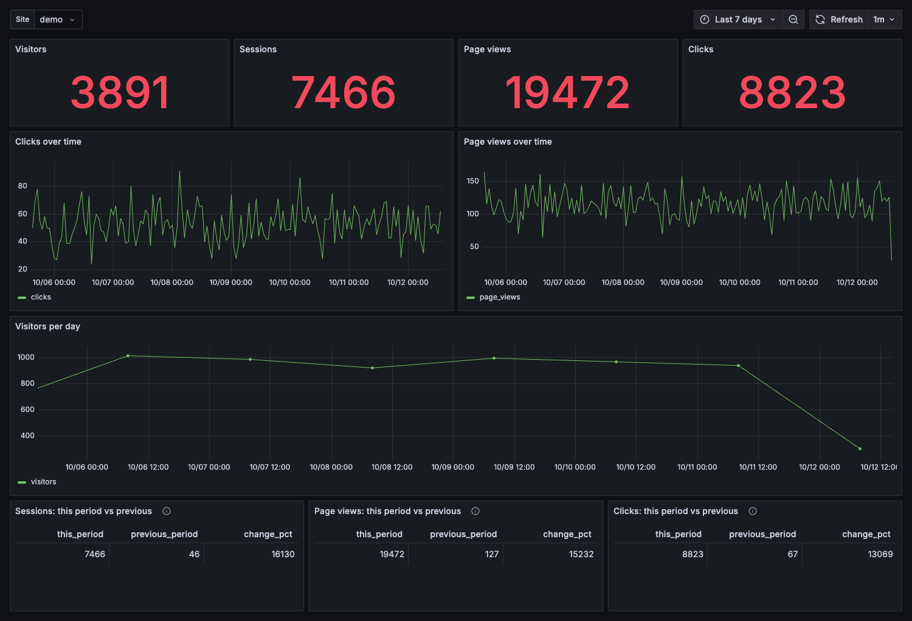

# GrepRUM

Product analytics and real-user monitoring in **one Rust binary**, on **GreptimeDB**.
Clicks, journeys, funnels, retention and sessions without running ClickHouse, Kafka and Postgres.
Privacy-safe by default: no IP stored, no input values, no query strings.


## Quick start (Docker)

```bash
git clone https://github.com/teochenglim/greprum && cd greprum
docker compose up -d                                  # GreptimeDB + GrepRUM + Prometheus + Grafana, tables created
docker compose --profile demo run --rm seed           # optional: 30 000 demo events (or: make demo)
open http://127.0.0.1:3000                            # Grafana, folder GrepRUM, Site = demo
```

No file to edit: the stack starts with a public demo site (`pk_demo`, API key `demo-api-key`). Your own keys:
[tutorials/05-going-to-production.md](tutorials/05-going-to-production.md).



**Tutorials:** [quickstart](tutorials/01-quickstart.md) · [add the tracker](tutorials/02-add-the-tracker.md) ·
[read the dashboards](tutorials/03-read-the-dashboards.md) · [your own tools on GreptimeDB](tutorials/04-your-own-tools.md) ·
[going to production](tutorials/05-going-to-production.md)

Add the tracker to your site (served from your own domain):

```html
<script async src="https://t.example.com/t.js" data-site="pk_xxx"
        data-features="scroll,errors,vitals,pageleave"></script>
```

Attribute and API reference: [tracker/README.md](tracker/README.md).

## Query API

`Authorization: Bearer <api key>` (stored hashed: `greprum hash-key <key>`), every call is scoped to the key's sites.

| Endpoint | Answers |
|---|---|
| `GET /api/v1/stats/overview` | DAU/WAU/MAU, sessions, clicks, page views (scaled + unscaled) |
| `GET /api/v1/stats/timeseries?metric=clicks&bucket=1h` | clicks or page views over time |
| `GET /api/v1/stats/top-pages` · `entry-pages` · `journeys` · `top-elements` | pages, entries, transitions, click targets |
| `GET /api/v1/stats/funnel?steps=a,b,c&window_seconds=1800` | ordered conversion (`window_seconds` required) |
| `GET /api/v1/stats/retention?days=7` | cohort retention |
| `GET /api/v1/stats/rage-clicks` · `browsers-devices?by=browser` | frustration, environment |
| `GET /api/v1/sessions` · `/sessions/{id}` · `/events` · `/usage` | lists and drill-down |

Dashboards: `ui/grafana/` (provisioning + 11 dashboards, one per screen).

## Operate

| Need | How |
|---|---|
| Config | `greprum.toml` (see [greprum.example.toml](greprum.example.toml)); env: `GREPRUM_LISTEN`, `GREPRUM_SPOOL_DIR`, `GREPRUM_GREPTIME_WRITE_URL` |
| Persistent volume | the spool (`/data` in the image); acknowledged events survive crash and DB outage |
| Metrics | `GET /metrics` (Prometheus), `GET /healthz` |
| Retention | `[greptime] ttl` (default 13 months) |
| Privacy | [docs/privacy.md](docs/privacy.md) |
| Decisions | [docs/adr/](docs/adr/) |

## Develop

```bash
make db-up          # GreptimeDB v1.2.1 in docker
make check          # fmt, clippy, traceability, tests, tracker tests + size budget
make test-db        # live integration tests
make spike N=1000000
```

## Licence

Apache License 2.0 - see [LICENSE](LICENSE) and [NOTICE](NOTICE).

Project docs: [PRD.md](PRD.md) · [ROADMAP.md](ROADMAP.md) · [RELEASE/](RELEASE/README.md) ·
[DESIGN/](DESIGN/) (requirements → AC → tests traceability in `DESIGN/00_*`) · [AGENTS.md](AGENTS.md).
