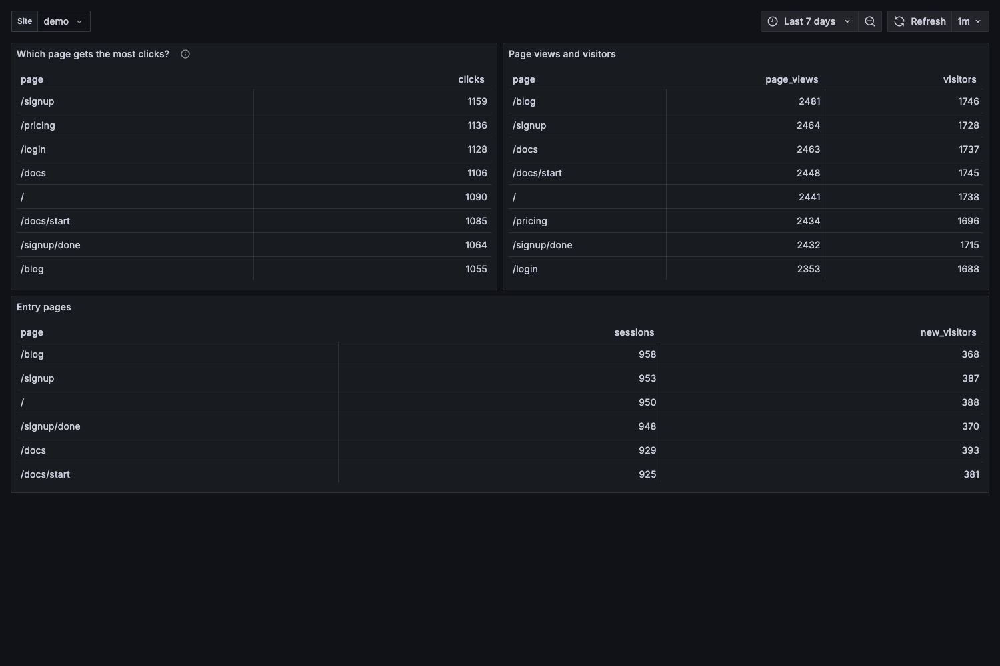
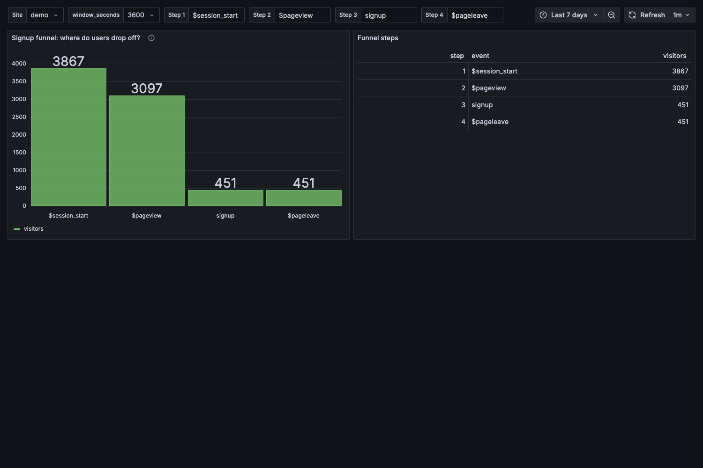
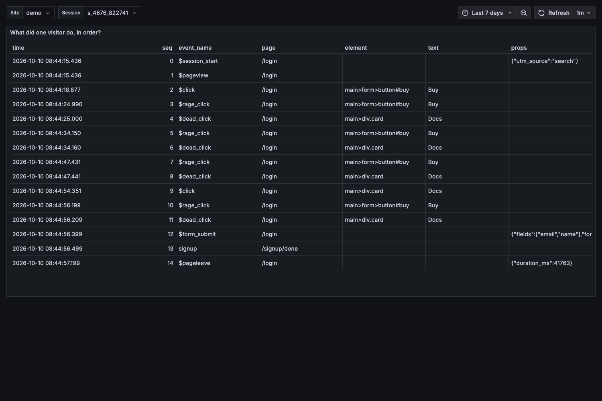

# Product owner walkthrough (no SQL)

Stack: `docker compose up -d` (GreptimeDB, GrepRUM, Prometheus, Grafana) — Grafana at
`http://127.0.0.1:3000`, anonymous viewer, folder **GrepRUM**. Pick your **Site** in the top-left
dropdown; the time range defaults to the last 7 days. Screenshots below are from a seeded demo site
(60 000 synthetic events, 7 days).

## Question 1 — "Which page gets the most clicks?"

1. Open **GrepRUM / Pages**.
2. The first panel, **Which page gets the most clicks?**, lists pages ordered by clicks. The top row is the answer
   (in the demo: `/signup`, 1 159 clicks).
3. **Page views and visitors** shows how many people viewed each page; **Entry pages** shows where sessions start
   and how many of them are new visitors.

## Question 2 — "Where do users drop off in the signup funnel?"

1. Open **GrepRUM / Funnels**.
2. Choose the steps with **Step 1 … Step 4** (event names, e.g. `$session_start`, `$pageview`, `signup`,
   `$pageleave`) and the **window_seconds** (how long a visitor has to finish; 300 s to 24 h).
3. **Signup funnel: where do users drop off?** draws one bar per step; **Funnel steps** gives the exact counts.
   The biggest drop between two bars is where users leave (in the demo: `$pageview` → `signup`).

## Follow-ups

| You want to know | Dashboard · panel |
|---|---|
| Is traffic up on last week? | **Overview** · *Sessions / Page views / Clicks: this period vs previous* |
| What do people click, and where do they get frustrated? | **Elements** · *What do people click?*, *Where do people get frustrated?* |
| Where do people go next from a page? | **Journeys** · *Where do people go next? (page transitions)* (set *From page*) |
| Who comes back? | **Retention** · *Who comes back?* (cohort, days later, retention %) |
| Which sessions had rage clicks or errors? | **Sessions** · *Which sessions had rage clicks or errors?* — click a session id |
| What did one visitor do, in order? | **Session detail** · *What did one visitor do, in order?* |
| Which browsers, systems, devices, countries? | **Browsers and devices** |
| Is the pipeline healthy? | **Usage** · *Spool fill and age of oldest unwritten event* |

## Notes

- Numbers on **Overview** come from hourly rollups (fast); lists of sessions and raw events read the
  event table and are capped to a 31-day window.
- Counts are exact for fully sampled sites. For sampled sites the API returns scaled and unscaled
  counts; the dashboards show unscaled counts.
- Gateway panels on **Usage** come from Prometheus and cover the last six hours.
