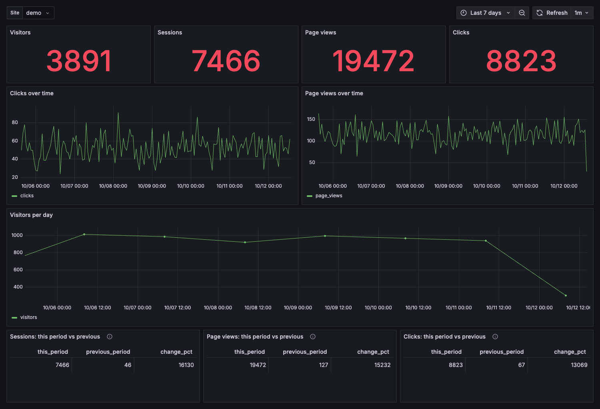

# 1. Five-minute quickstart

You need Docker with the compose plugin. Nothing else: no Rust, no Node, no config file to edit.

## Start everything

```bash
git clone https://github.com/teochenglim/greprum && cd greprum
docker compose up -d
```

Four services start; there are no one-shot containers. The `greprum` container runs `greprum playground`
([ADR 0053](../docs/adr/0053-playground-inits-and-serves-in-one-process.md)): it waits for GreptimeDB,
creates the tables and Flow rollups, seeds demo data, then serves the gateway:

| Service | Port | What it is |
|---|---|---|
| `greptime` | 4000 HTTP, 4002 MySQL | GreptimeDB v1.2.1, the only database |
| `greprum` | 8080 | one container that migrates, seeds and serves: tracker (`/t.js`), ingest (`/collect`), query API (`/api/v1/*`), `/metrics` |
| `prometheus` | 9090 | scrapes GrepRUM's own `/metrics` |
| `grafana` | 3000 | 11 provisioned dashboards, anonymous viewer |

Check it:

```bash
curl http://127.0.0.1:8080/healthz        # ok
```

Port clash? Override with `GREPRUM_PORT`, `GRAFANA_PORT`, `GREPTIME_HTTP_PORT`, `GREPTIME_MYSQL_PORT`,
`PROMETHEUS_PORT`.

## Demo data

The first start seeds 30 000 deterministic synthetic events for site `demo` (7 days of sessions, clicks,
rage clicks, errors, several countries and devices) before the gateway binds :8080 — give it a minute.
Afterwards a restart or another `docker compose up -d` skips straight to serving: the playground only
seeds when the site has no events in that window. `make demo` is the same thing in one command.

## Open Grafana

<http://127.0.0.1:3000> opens **GrepRUM / Overview** (anonymous viewer; `admin` / `admin` to edit).
Pick **Site** = `demo` in the top-left drop-down. Rollups appear within a few seconds.



The folder **GrepRUM** holds one dashboard per question:

| Dashboard | Answers |
|---|---|
| Overview | traffic, visitors, sessions, this period vs previous |
| Pages | which pages get clicks and views; where sessions start |
| Elements | what people click; where they get frustrated |
| Journeys | where people go next from a page |
| Funnels | where users drop off between steps |
| Retention | who comes back |
| Sessions · Session detail | which sessions had rage clicks or errors; one visitor's timeline |
| Events | the raw event stream |
| Browsers and devices | browser, OS, device, country |
| Usage | pipeline health: spool fill, age of the oldest unwritten event |

## What just happened

```
docker compose up -d
  greptime  starts
  greprum   playground: waits for GreptimeDB, creates the tables + flows, seeds demo data once, serves
  grafana   provisions the GreptimeDB (MySQL) and Prometheus data sources + 11 dashboards
```

The demo configuration is [docker/quickstart.toml](../docker/quickstart.toml). Its keys are public: it is
for learning, not for the internet (see [tutorial 5](05-going-to-production.md)).

## Clean up

```bash
docker compose down        # keep data
docker compose down -v     # delete GreptimeDB, spool and Grafana volumes
```

Next: [add the tracker to a real page](02-add-the-tracker.md).
