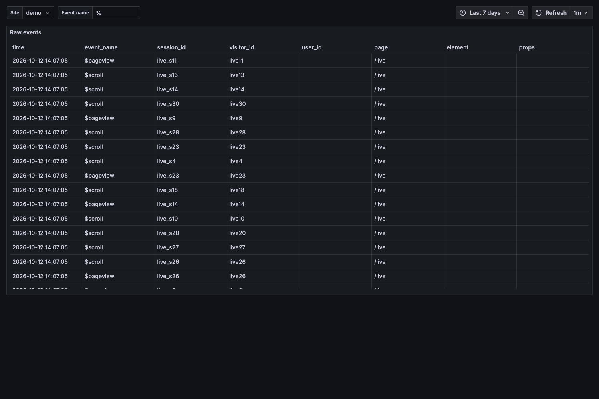

# 2. Add the tracker to your site

After [tutorial 1](01-quickstart.md) the gateway is running with a demo site (`pk_demo`).

## The one line

```html
<script async src="http://127.0.0.1:8080/t.js" data-site="pk_demo"
        data-features="scroll,errors,vitals,pageleave"></script>
```

- The script is served by **your** gateway (own domain, not blocked as a third party). Core ≤ 3 KB gzipped,
  everything ≤ 5 KB.
- It records page views (including SPA route changes), clicks on buttons and links, and optionally scroll depth,
  JavaScript errors, Core Web Vitals (LCP, CLS, INP) and page leave.
- It never sends IP addresses, typed values or URL query strings.

## Try it on the demo page

```bash
python3 -m http.server 8000 -d docker/demo-site
```

Open <http://localhost:8000>, click **Start free**, **Add to cart** and **Break something** a few times,
then open Grafana → **GrepRUM / Events** (set **Site** = `demo`). Events are batched (flushed about a second after the
first one, and on page leave); allow up to a minute for the hourly rollups on **Overview**.



Why does `http://localhost:8000` work? The site's `origins` list in
[docker/quickstart.toml](../docker/quickstart.toml) allows exactly that origin. `/collect` rejects other
origins before reading the body.

## Name your own events

```html
<button data-track="add_to_cart">Add to cart</button>
<script>
  greprum.track("checkout_started", { plan: "pro", seats: 3 });
</script>
```

Named events are what funnels use ([tutorial 3](03-read-the-dashboards.md)).

## Rage and dead clicks, errors, sampling

| You want | Attribute |
|---|---|
| sample 25% of sessions | `data-sample-rate="0.25"` |
| tag deployments | `data-env="prod" data-release="1.4.2"` |
| wait for consent | `data-consent="required"` then `greprum.consent("granted")` |
| keep text out of events | mark elements `data-private` (text becomes `***`) |
| restrict pages | `data-include-pages="/app/*"` or `data-exclude-pages="/admin/*"` |

Full list: [tracker/README.md](../tracker/README.md).

## Check that events arrive without Grafana

```bash
curl -s -H "Authorization: Bearer demo-api-key" \
  "http://127.0.0.1:8080/api/v1/stats/overview?site=demo" | head -c 600
```

Next: [read the dashboards](03-read-the-dashboards.md).
