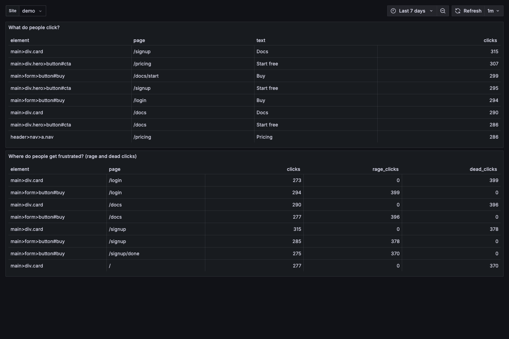
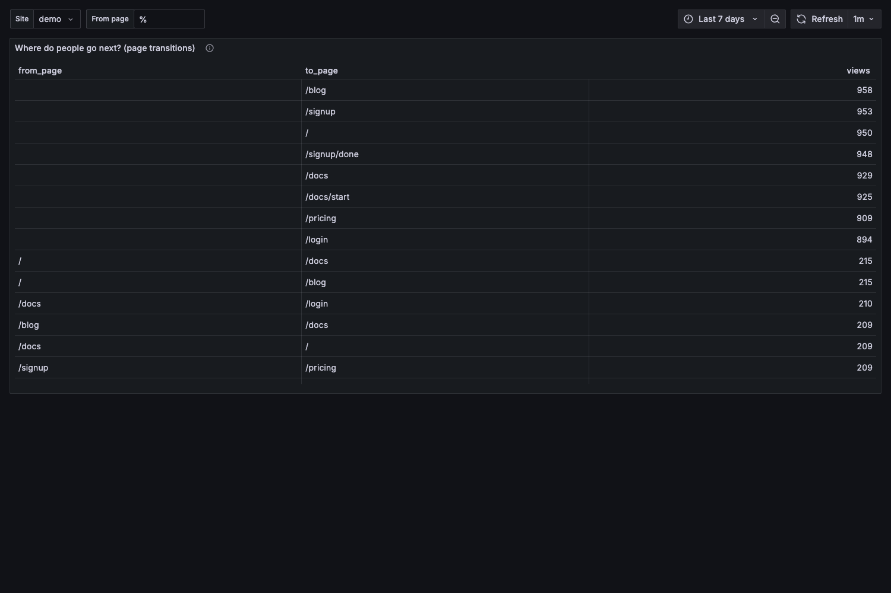
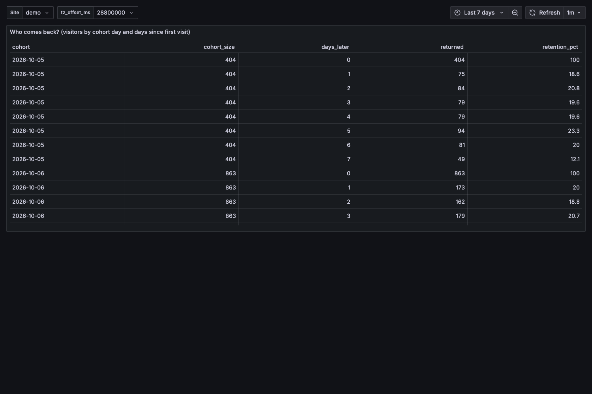
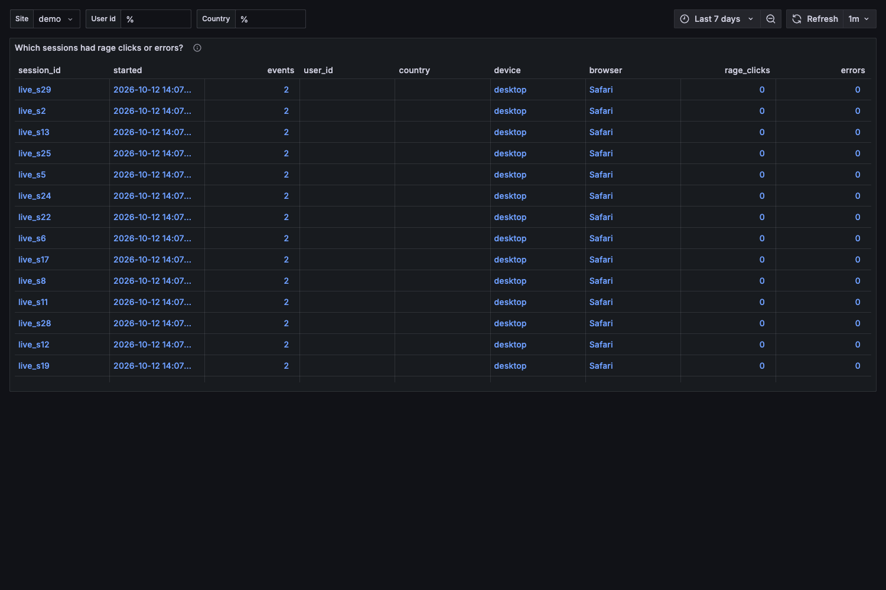
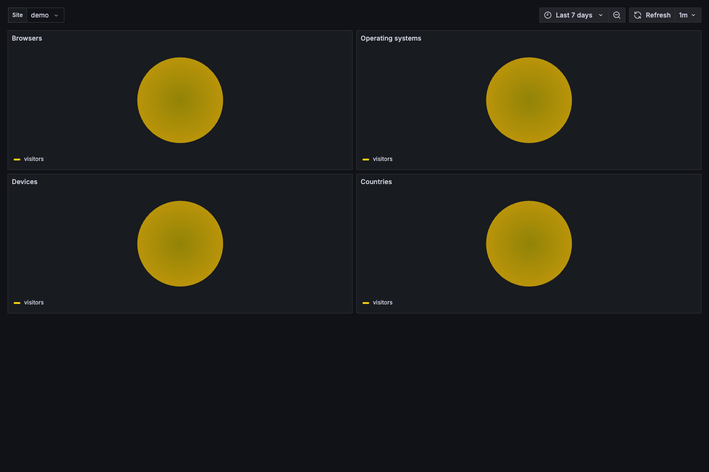
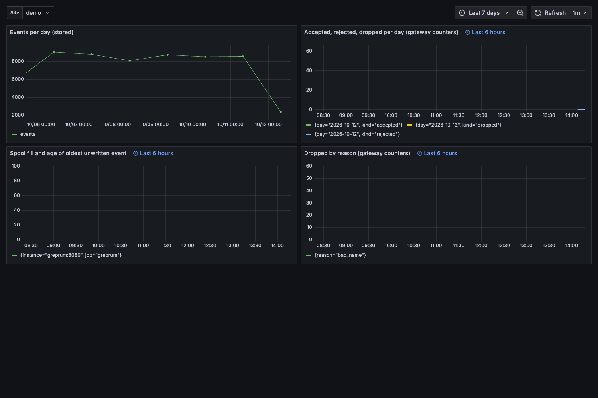

# 3. Read the dashboards

Open Grafana at <http://127.0.0.1:3000>, folder **GrepRUM**, and pick the **Site** in the top-left drop-down.
The time range defaults to the last 7 days. Everything below was captured on the seeded demo site.

## "How is traffic doing?" · Overview

Sessions, page views and clicks for this period versus the previous one, DAU/WAU/MAU, and a time series.
Overview reads hourly rollups, so it stays fast on large sites.

## "Which page gets the most clicks?" · Pages

The first panel lists pages by clicks; the top row is the answer. **Entry pages** shows where sessions start and
how many of those visitors are new.

## "What do people click, and where do they get frustrated?" · Elements

Click targets ranked by count (tag, id, text) and **rage clicks**: three or more rapid clicks in a small area.
Dead clicks (nothing happened) are marked too.

## "Where do people go next?" · Journeys

Page-to-page transitions. Set **From page** to see where visitors go after it.

## "Where do users drop off?" · Funnels

Choose up to four steps (event names such as `$session_start`, `$pageview`, `signup`, `$pageleave`) and the
**window_seconds** a visitor has to finish. The biggest drop between two bars is where users leave.

## "Who comes back?" · Retention

Cohorts by first-seen day, with the share of each cohort active 1, 2, … days later.

## "Which sessions went wrong?" · Sessions → Session detail

**Sessions** lists sessions with rage clicks or errors; click a session id to open **Session detail**, which
replays what that visitor did, in order.

## "Which browsers, systems, devices, countries?" · Browsers and devices

## "Is the pipeline healthy?" · Usage

Spool fill and the age of the oldest unwritten event (from Prometheus), plus accepted/shed counters. A growing
age means GreptimeDB is slow or down; events are safe in the spool and drain when it returns.

## Notes

- Counts are exact for fully sampled sites; for sampled sites the API returns scaled and unscaled counts and the
  dashboards show unscaled counts.
- Lists of sessions and raw events read the event table and are capped to a 31-day window.

Next: [use your own tools](04-your-own-tools.md).
