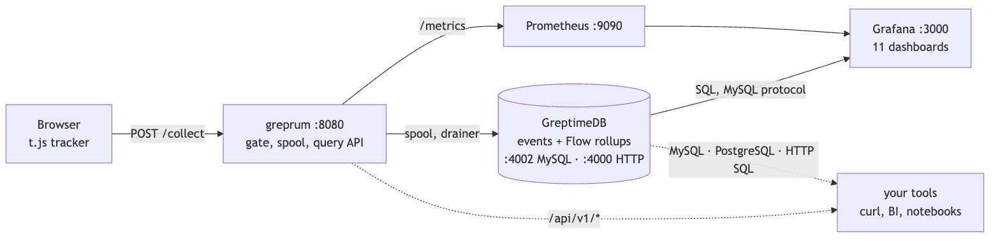

# Tutorials

Product analytics and RUM on GreptimeDB, from zero to a Grafana dashboard. Each tutorial is short and
every command in it is tested against the files in this repository.

| # | Tutorial | You will | Time |
|---|---|---|---|
| 1 | [Five-minute quickstart](01-quickstart.md) | start GreptimeDB, GrepRUM, Prometheus and Grafana with one command and see seeded dashboards | 5 min |
| 2 | [Add the tracker to your site](02-add-the-tracker.md) | put one script tag on a page and watch your own clicks arrive | 10 min |
| 3 | [Read the dashboards](03-read-the-dashboards.md) | answer product questions without writing SQL | 15 min |
| 4 | [Use your own tools on GreptimeDB](04-your-own-tools.md) | query the tables from `mysql`, Grafana, BI tools or the HTTP API | 10 min |
| 5 | [Going to production](05-going-to-production.md) | real keys, origins, retention, read-only user, backups | 20 min |

What is in the box:

Source: [images/architecture.mmd](../images/architecture.mmd) (Mermaid; re-render with
`npx @mermaid-js/mermaid-cli -i images/architecture.mmd -o images/architecture.png -s 2`).

Screenshots come from a seeded demo site (30 000 synthetic events over 7 days) and are regenerated with
`make` + `tracker/browser/screenshots.mjs`.
